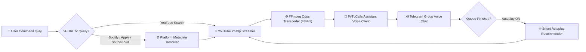

<div align="center">


<p align="center">
  
</p>

[](https://www.python.org/)
[](https://docs.pyrogram.org/)
[](https://github.com/pytgcalls/pytgcalls)
[](https://www.mongodb.com/)
[](https://www.docker.com/)
[](./LICENSE)
[](https://t.me/DEVTAL)

<br/>

[🎮 Interactive Web Studio](index.html) • [🚀 Deploy on Heroku](https://dashboard.heroku.com/new?template=https://github.com/SUDEEPBOTS/PulseMusic) • [⚡ Deploy on Render](https://render.com/deploy?repo=https://github.com/SUDEEPBOTS/PulseMusic) • [💬 Support Chat](https://t.me/DEVTAL)

</div>

---

## ⚡ What is PulseMusic?

**PulseMusic** is a high-throughput, enterprise-grade Telegram Voice Chat & Video Streaming Bot built on **Pyrogram v2** and **PyTgCalls**. Designed for audiophiles and communities that demand crystal-clear **Opus 48kHz audio** with zero stutter, PulseMusic natively resolves links from YouTube, Spotify, Apple Music, SoundCloud, and direct Telegram audio/video files with millisecond stream handshakes.

---

## ✨ Core Highlights & Architecture

- 🎧 **Audiophile Sound Quality**: Streams uncompressed audio using FFmpeg with native Opus transcoding at up to 320 kbps stereo.
- 📺 **HD Video Streaming**: Full video chat playback with dynamic frame pacing and resolution scaling.
- 🌐 **Multi-Platform Audio Resolvers**:
  - **YouTube & YouTube Music**: Instant query token matching and live stream extraction.
  - **Spotify Playlists & Albums**: Seamless metadata conversion and lossless downstream resolution.
  - **Apple Music & SoundCloud**: Deep link scrapers with artist radio support.
  - **Telegram Local Media**: Play any forwarded audio, voice message, or video document directly.
- ♾️ **Smart Autoplay AI**: When a user queue finishes, PulseMusic analyzes recent track genres and automatically queues related songs without dropping the voice call.
- 🛡️ **Anti-Flood & Channel Play Shield**: Dynamic rate limiting prevents spam; channel linking allows administrators to stream music from their channel directly into linked group voice chats.
- 🌐 **Built-in Keepalive Web Server**: Integrated HTTP listener (`server.py`) ensures 100% 24/7 uptime on free-tier platforms like Render and Heroku without idling out.
- 🌍 **Multi-Language Localization**: Full translation support for **English**, **Hindi**, **Punjabi**, and **Arabic**.

---

## 🔄 Audio Streaming Pipeline



---

## 🚀 Quick Start & Deployment

### Method 1: Local / VPS (PM2 — 24/7 Recommended)

```bash
# 1. Clone repository
git clone https://github.com/SUDEEPBOTS/PulseMusic.git
cd PulseMusic

# 2. Setup Virtual Environment
python3 -m venv venv
source venv/bin/activate

# 3. Install dependencies
pip install --upgrade pip setuptools wheel
pip install -r requirements.txt

# 4. Configure credentials
cp sample.env .env
nano .env

# 5. Start with PM2
pm2 start "bash start" --name PulseMusic
pm2 save
pm2 startup
```

### Method 2: Docker & Docker Compose

```bash
# 1. Configure environment
cp sample.env .env
nano .env

# 2. Build and launch container stack
docker compose up -d --build

# 3. View live streaming logs
docker compose logs -f pulsemusic
```

### Method 3: One-Click Cloud Hosting

| Platform | Deployment Button | Configuration File |
| :--- | :---: | :--- |
| **Heroku** | [](https://dashboard.heroku.com/new?template=https://github.com/SUDEEPBOTS/PulseMusic) | [`heroku.yml`](./heroku.yml) / [`Procfile`](./Procfile) |
| **Render** | [](https://render.com/deploy?repo=https://github.com/SUDEEPBOTS/PulseMusic) | [`Dockerfile`](./Dockerfile) |

---

## ⚙️ Environment Variables

Create a `.env` file in the project root:

| Variable | Required | Default | Description |
| :--- | :---: | :---: | :--- |
| `API_ID` | **Yes** | — | Telegram API ID from [my.telegram.org](https://my.telegram.org) |
| `API_HASH` | **Yes** | — | Telegram API Hash from [my.telegram.org](https://my.telegram.org) |
| `BOT_TOKEN` | **Yes** | — | Telegram Bot Token from [@BotFather](https://t.me/BotFather) |
| `OWNER_ID` | **Yes** | — | Numeric User ID of the primary administrator |
| `LOGGER_ID` | **Yes** | — | Telegram Channel/Group ID (`-100xxx`) for playback & error logs |
| `MONGO_DB_URI` | **Yes** | — | MongoDB Atlas connection string (`mongodb+srv://...`) |
| `STRING_SESSION` | **Yes** | — | Pyrogram v2 string session for the assistant account |
| `SPOTIFY_CLIENT_ID` | No | — | Spotify Developer Client ID (for high-speed playlist resolution) |
| `SPOTIFY_CLIENT_SECRET` | No | — | Spotify Developer Client Secret |
| `DURATION_LIMIT` | No | `54000` | Maximum song duration limit in minutes |
| `AUTO_LEAVING_ASSISTANT`| No | `False` | Assistant auto-leaves voice chat when idle |
| `AUTO_SUGGESTION_MODE` | No | `True` | Enable continuous smart autoplay when queue is empty |
| `CLEANMODE_MINS` | No | `5` | Minutes after which command messages are pruned |
| `RENDER` | No | `False` | Set `True` on Render to launch background keepalive HTTP ping |

---

## 🤖 Command Reference

### 🎵 Playback Commands
| Command | Permission | Description |
| :--- | :---: | :--- |
| `/play <query/url>` | Everyone | Plays the requested song in group voice chat |
| `/vplay <query/url>` | Everyone | Streams high-definition video in voice chat |
| `/cplay <query/url>` | Admins | Plays music in the linked channel's voice chat |
| `/pause` | Admins | Pauses the current audio/video stream |
| `/resume` | Admins | Resumes the paused stream |
| `/skip` | Admins | Skips current song to next queue item |
| `/end` or `/stop` | Admins | Stops playback, clears queue, and leaves voice chat |
| `/queue` | Everyone | Displays the active queue and upcoming tracks |
| `/seek <seconds>` | Admins | Fast-forwards or rewinds active track |
| `/speed <0.5 - 2.0>` | Admins | Adjusts stream playback speed |

### 🛠️ Bot Management & Utility Commands
| Command | Permission | Description |
| :--- | :---: | :--- |
| `/start` | Everyone | Opens interactive inline menu with language selectors |
| `/help` | Everyone | Comprehensive user guide and command catalog |
| `/ping` | Everyone | Checks bot latency and voice chat buffer response |
| `/stats` | Everyone | Shows active chats, assistant health, and system specs |
| `/settings` | Admins | Configures group-level audio quality, cleanmode, and voting |
| `/addsudo <user_id>` | Owner Only | Grants sudo permissions to an operator |
| `/sudolist` | Sudo / Owner | Lists all authorized sudo operators |

---

## 🛡️ Operational Best Practices

> [!TIP]
> **Assistant Userbot Recommendations:**
> - Use a secondary Telegram account for your assistant `STRING_SESSION`.
> - Ensure the assistant account is an admin in the target group with voice chat privileges.
> - For large multi-chat deployments, configure `STRING_SESSION2` and `STRING_SESSION3` to load-balance across multiple assistant clients.

---

## 📄 License & Attribution

This project is licensed under the **MIT License** — see the [`LICENSE`](./LICENSE) file for details.

Copyright © 2026 **[SUDEEPBOTS](https://github.com/SUDEEPBOTS)**. All Rights Reserved.

- **Developer & Owner**: [@Zcziiyy](https://t.me/Zcziiyy)
- **Community Chat**: [@DEVTAL](https://t.me/DEVTAL)
